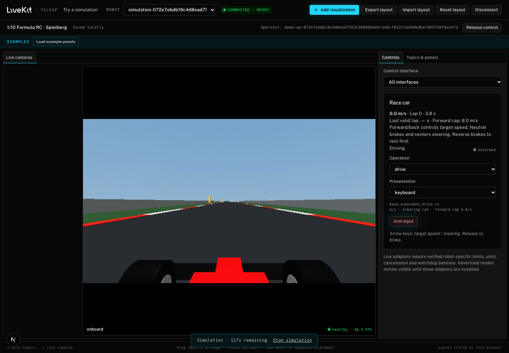

# Formula RC implementation validation

Date: 2026-11-09. Local development machine: Apple M4 Pro, macOS, Python 3.12,
MuJoCo 4.0.0, NumPy 2.5.4, pinned LiveKit Python 1.2.1. These measurements are
local observations, not a hosted capacity or WAN latency guarantee.

## Implemented

- `python -m sims run f1tenth`, asset fetching, discovery checks, physics-only
  mode, previews and local benchmarks.
- Pinned community Spielberg data with its existing 2.20 m width and measured
  closed centerline length of 343.3226 m. Pinned Gym dimensional/parameter baseline
  and explicit additional provisional parameters in `vehicle.json`.
- A planar nonlinear four-wheel car with steering response, four-wheel drive,
  braking/reverse transition, combined tire-force limits, grass grip, barrier
  response, track progress and lap timing.
- A generated 3D scene and forward onboard video. Classic and Filament previews
  both rendered successfully. Matching mono-camera calibration validates.
- Portal ownership, a fresh-publication/neutral gate, strict Ackermann parsing,
  independent command timeout, overload disarm, JSON vehicle state and odometry.
- Manual-discovery and managed-session browser adapters, keyboard/joystick/gamepad
  controls, speed/lap telemetry and a Formula RC `/try` card.

## Checks completed

| Check | Observed result |
| --- | --- |
| Python unit discovery | 93 tests, 88 passed and 5 opt-in/dependency skips, including the handling regression. |
| RC native LiveKit integration | Passed with decoded 320×180 onboard video; actual drive, timeout braking, fresh track after timeout, handoff, role loss, track closure, disconnect and reconnect. |
| Existing arm native integration | Single- and dual-arm gateway checks passed. The test now recognizes the separately published battery schema. |
| Web unit tests | 146 passed across 8 files, including progressive analog/keyboard and legacy steering mappings. |
| Web TypeScript | Passed with no emit. |
| Web lint on changed files | Zero errors or warnings. |
| Browser integration/regression | Original 16 passed; after the keyboard correction, the updated driving test and 9 workspace regressions passed. |
| Asset/image catalog | Required managed-scene asset checks passed locally. |
| Numerical checks | Stopping trajectory agrees within 2% at 200/400 Hz; low-speed turning radius agrees with steering geometry within 2%; tire forces remain within the combined friction budget. |
| Offline circuit traversal | A test-only path follower completed a valid community Spielberg lap at a 3 m/s target in 119.82 simulation seconds. Maximum observed center offset was 0.353 m. |

The browser driving test launched a session through `/try`, received decoded
video, selected keyboard input, acquired control, accelerated above 1 m/s, braked
below 0.15 m/s on release, and reloaded without rearming. Local transport tests
use isolated rooms on a localhost development server. The web test is opt-in as
`TELEOP_RACING_E2E=1` and requires the session service and updated web app.

## Performance

For a ten-simulation-second physics-only benchmark, measured compute time was
0.632 s, or 15.8× real time, with p99 outer-step cost about 0.436 ms. The outer
step is 5 ms and contains wheel-integration substeps of at most 1 ms.

A 12-second camera benchmark at 960×540 and a 60 fps target submitted roughly
59–60 frames/s. Mean frame work was 5.4–5.8 ms; p95 was 6.9–7.2 ms. This includes
physics scheduling, renderer/readback and capture into a LiveKit video source,
and excludes encoding and network delivery. The separate native/browser checks
confirmed actual decoded video delivery.

The ten-minute moving-car soak completed five valid laps. Wall time was
600.0021 s, simulation advanced 599.4500 s, and real-time factor was **0.99908**.
The last valid lap took 119.56 s. Video windows averaged approximately 59.8 fps;
one contention interval fell to 42.6 fps. There were **two scheduler overload
stops**, so the harness correctly exited with a failure: the proposed zero-overload
acceptance criterion is **not met** on this shared development host. The overall
real-time-factor target was met; uninterrupted operation was not established.

The reproducible harness is `PYTHONPATH=. .venv/bin/python tests/f1tenth_soak.py`.
It drives with test input around the track while rendering/capturing at 60 fps,
checks real-time factor and rejects scheduler overloads. Its test driver directly
sets vehicle targets after a stop; this is not a claim that an operator can drive
through disarm without reacquiring control. Normal teleop requires a fresh request.

An earlier concurrent run with Next.js/TypeScript/browser compilation saturated
the development machine enough to trigger the 100 ms overload stop. The offline
test path initially tried to update a disconnected participant; that cleanup
error was fixed. Overload stops remain intentional. A heavily loaded host can
drop below the video target and disarm the car; the pool's 20-session cap is not
a measured safe number of simultaneous driving sessions.

## Remaining limits

### Handling correction after operator feedback

A scripted reproduction accelerated to approximately 7.68 m/s, held 0.05 rad
(2.9°) steering, then requested zero speed. The original equal reverse-motor
torque could accelerate a rear wheel backward to −266 rad/s while the chassis
still moved forward, removing rear cornering grip. Peak sideslip while body-forward speed exceeded 0.5 m/s
was 79° and yaw rate reached 570.5°/s.

Braking now uses a passive impulse that reduces wheel rotation to zero without
reversing it, with demand distributed by current normal load. In the same
reproduction, peak sideslip was 5.3°, peak yaw rate 40.4°/s, and the vehicle
stopped. A regression test checks forward wheel rotation, sideslip, yaw response
and stopping. The load-based brake distribution remains a modeling approximation,
not a measured brake-bias specification for physical RoboRacer hardware.

The updated browser also uses the simulator's declared squared analog-steering
curve for both gamepad and on-screen joystick. Quarter input requests about 1.5°
rather than 6°, while full travel retains the 24° mechanical envelope. Direct
Ackermann angle commands are unchanged. Full-lock steering at the 8 m/s speed
cap still exceeds the modeled grip envelope. Earlier lap/soak measurements above
precede this handling correction and were not rerun as a ten-minute acceptance
test for this change. The updated native command/telemetry test passes, as do
the 17 car unit tests, the complete Python suite, web unit tests, type check and
lint on the changed web files.

Keyboard follow-up: keyboard steering now accumulates normalized input at 0.8/s
while a turn key is held and returns toward center at 3.2/s on release or a
direction change. The existing progressive curve then converts it to radians.
The input state is local to an armed input session and clears on release of
ownership, disarm, mode changes and focus loss. Forward/reverse key release still
sends zero target speed immediately. Timer gaps are capped at 50 ms to avoid a
stalled browser suddenly requesting full lock.

For a 0.3-second keyboard turn stimulus near 17 mph, the scripted vehicle test
observed about 1.01° peak steering, 1.04° sideslip and 13.69°/s yaw rate, returning
to centered steering. Unit checks cover short taps, full travel, opposite turns,
reset and irregular timer intervals. A browser regression checks the actual
measured steering track during a short key press at speed, centering on release,
and subsequent braking.
The first browser attempt pressed a key before asynchronous arming and neutral
readiness had completed. The regression now waits explicitly for the armed
control before sending input. With that readiness check, the real managed
driving test passed, along with 9 workspace regressions. The input still requires
neutral before motion; that guard was preserved.

Instrument follow-up: 11 dedicated JSON DataTracks were added for the approved
speed, F/N/R drive state, battery energy, steering/yaw, acceleration, lap-time
and track-progress examples. All 16 car unit tests pass, including units,
braking before reverse, idle/load energy consumption, no regeneration, empty-pack
behavior and retention of the last valid lap after an invalid lap.

Publishing every instrument as one burst exposed starvation of earlier streams
in the local lossy transport: aggregate state moved while `/speed_mph` stayed at
its initial sample. Spreading publications across the 50 ms cycle resolved the
observed stall. The localhost test receives all schemas/tracks, verifies changing
speed/gear/energy and decoded video, and checks continued samples from every
instrument, including instruments whose values remain constant. No dedicated
contact/slip or command-diagnostic tracks were added.

The energy model is a provisional 55.5 Wh RC pack with estimated idle and drive
losses, integrated in simulation time. The existing battery-voltage publication
uses the same pack estimate. It has not been fitted to a physical discharge curve.

This first implementation is RC-inspired rather than hardware calibrated. The
nonlinear tire curves, wheel inertia/radius and actuator response include explicit
provisional assumptions. Four-wheel drive currently distributes equal torque;
it does not include a tuned center differential or detailed driveline compliance.

Dynamics are flat: no suspension, banking, road elevation, curb hops or rollover.
Curbs are visual markers; tires outside the paved road use grass grip. Barrier
response constrains the oriented footprint using local track geometry and dampens
impact velocity; it is an approximate contact model rather than a detailed crash
simulation. Rendering uses the latest physics snapshot without additional visual
interpolation. No audio or steering-wheel force feedback is implemented.

The Ackermann interface requests target speed and steering. Neutral brakes and
centers the steering; independent throttle/brake/coasting would require another
explicit command profile. The default forward cap is a provisional 8 m/s, with a
configurable upper ceiling of 20 m/s from the community preset.

WAN delay/jitter operating limits, experienced RC-driver assessment, physical-car
parameter fitting and multi-session deployment capacity remain unmeasured. No
service was deployed. See [the simulator README](../sims/f1tenth/README.md) for
launch and validation commands.
